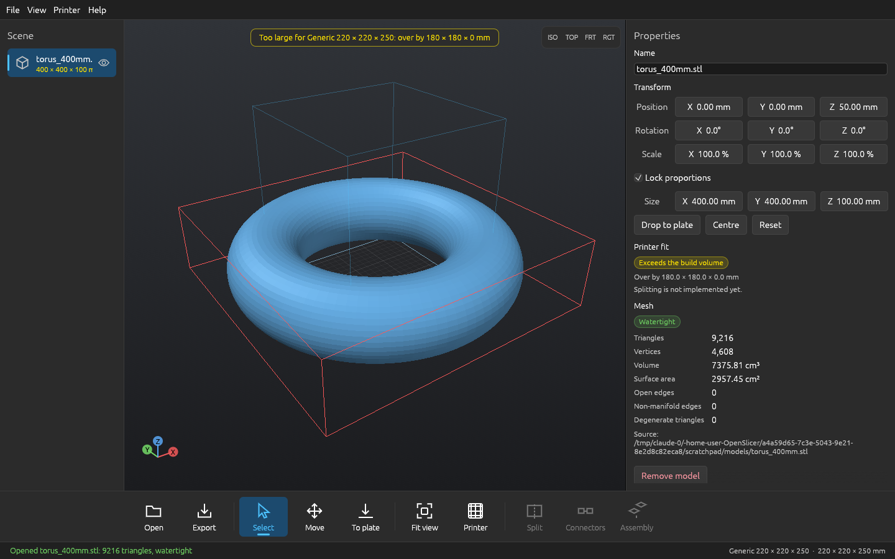

# OpenSlicer

**Open-source, offline software for splitting oversized 3D models into printable parts, joining them with real printable connectors, and planning the assembly.**

OpenSlicer is written entirely in Rust. It runs locally, with no account, subscription, cloud service or network connection. It is intended as an open alternative to commercial large-model splitting tools such as LuBan 3D.

> **Project status: pre-alpha.**
> The geometry engines and the command-line tool are implemented and tested on real generated geometry: cutting, auto-tiling, connectors, nesting, alternative construction methods, Booleans, repair, hollowing, image tools, export with manifest and verification, project files. The desktop app opens STL/OBJ/3MF, inspects and transforms models, and has a **Split window** (automatic, grid or every-N-mm layouts; connector type, size and clearance; nesting; assembly check) that runs the same pipeline as the CLI in a background job, shows the parts in the viewport with a pass/fail summary, and exports the parts, instructions and verified manifest. Alternative construction methods, image tools, hollowing and Booleans are CLI-only for now. The Windows `.exe` is built by CI but has not been run on a real Windows machine yet. See [docs/known-limitations.md](docs/known-limitations.md).



*The current skeleton showing a 400 mm torus that does not fit a 220 × 220 mm printer. The screenshot was captured on Linux under software OpenGL.*

OpenSlicer is an independent project. It is not affiliated with, endorsed by, or derived from the source code of LuBan 3D or any other commercial product.

---

## What works today

Everything below is implemented and exercised by automated tests or by running the real application:

- **STL import:** binary and ASCII, auto-detected by exact size (so binary files that begin with the word "solid" load correctly). NaN/infinite coordinates and truncated files are rejected with a clear error.
- **Vertex welding on import** within 1e-6 of the model's bounding-box diagonal, so floating-point noise in exported files does not create false open edges. Original coordinates are preserved.
- **Mesh inspection:** triangle and vertex counts, surface area, enclosed volume, open (boundary) edges, non-manifold edges, degenerate triangles, and detection of inverted normals. Back faces render orange in the viewport.
- **3D viewport:** OpenGL renderer with flat shading, build plate with grid, build-volume wireframe, axis triad, orbit / pan / zoom, view presets, click-to-select, and a Move tool that drags a model across the plate.
- **Transforms:** numeric position, rotation, scale, size, drop-to-plate, centre. Exports have the transform baked in (winding is corrected for mirrored models).
- **Printer profile:** editable build volume and margin with presets, saved between sessions. Every model is checked against the usable volume and over-size is reported per axis.
- **Export:** binary STL, written to a temporary file, **re-imported and compared** (triangle count, volume, bounds) before being atomically renamed into place. A failed export never replaces an existing file.
- **Background jobs:** opening and exporting run on worker threads with a progress indicator and a Cancel button. Cancelling discards the result and leaves no files behind; a phase already in progress finishes first.
- **Multiple models**, drag-and-drop of files onto the window, and command-line file arguments (`openslicer model.stl`).
- **Forced dark theme** styled after Windows 11 / 3D Builder: command bar along the bottom, scene list on the left, properties on the right. Segoe UI is used automatically when installed.

Measured on a 1,000,000-triangle (50 MB) STL under software OpenGL in a Linux container: loaded and displayed in under 3 seconds with about 260 MB resident memory, and reported the correct volume for the analytic shape.

## Command-line tool (`openslicer-cli`)

All engines are available headless and are what the automated end-to-end tests exercise.

```sh
openslicer-cli printers                                   # built-in printer presets
openslicer-cli info model.stl --printer ender             # size, volume, mesh health, fits?
openslicer-cli repair broken.stl fixed.stl                # weld, orient, fill small holes
openslicer-cli split big.stl -o out --connector pin --nest --verify-assembly
openslicer-cli split a.stl b.obj -o out --layout grid --grid 3,2,1 --format 3mf   # batch
openslicer-cli split big.stl -o out --layout planes --plane 0,0,120:0,0,1
openslicer-cli verify out                                 # re-import and check an export
openslicer-cli fab stack|interlock|blocks|plates|wireframe|relief model.stl -o out
openslicer-cli image lithophane|relief|halftone photo.png -o out --width 120
openslicer-cli hollow solid.stl hollow.stl --wall 3 --drain-holes 2
openslicer-cli boolean union|subtract|intersect a.stl b.stl out.stl
```

Exit codes: `0` success, `1` failure, `2` usage error, `3` finished but the result has problems (parts that do not fit, failed checks). A result with problems is still written so it can be inspected. A split writes one file per part (STL, OBJ or 3MF), optional per-plate files, `*_instructions.html` (parts list, connector table, exploded overview and a diagram per step) and `manifest.json` with SHA-256 hashes, validation results and the assembly sequence. Every export is re-imported and compared before it is reported as done; a failed or cancelled export leaves no files behind.

What the engines do (all verified by tests; see the crate tests for the exact claims):

- **Cutting:** exact plane cuts with capping, verified watertight and volume-conserving; grid, modular, brick and arbitrary-plane layouts; automatic tiling that searches grid rotation and axis assignment so every piece fits the printer including connector allowance; separation of disconnected solids; merging of sliver pieces.
- **Connectors:** pin, dowel, dovetail, tab-and-slot, puzzle, lip (follows the cut boundary), lap joint, terrace, pyramid and claw. Placement is automatic, clearance is configurable, thin walls shrink the connector or skip with an explanation. Each connector is validated against the real pieces with Booleans, and the finished assembly can be checked for interpenetration.
- **Machine-aware output:** build volume and margin, fit check of every part in every orientation, print-orientation export, rectangle nesting onto plates.
- **Other construction methods:** stacked layers (with SVG outlines for laser/CNC), interlocking ribs, blocks, plates, wireframe, depth relief.
- **Mesh operations:** union, subtraction, intersection (via `boolmesh`), repair, hollowing with drain holes.
- **Image tools:** lithophane, image relief, halftone plate.

---

### Keyboard shortcuts

| Key | Action |
|---|---|
| Ctrl+O / Ctrl+E | Open / export selected model |
| F | Fit view to selection (or plate) |
| 1 2 3 4 | Isometric / top / front / right view |
| Delete | Remove selected model |
| Esc | Back to Select tool |
| Left drag | Orbit (or move model with the Move tool) |
| Right / middle drag, Shift + left drag | Pan |
| Scroll | Zoom |
| Double-click | Fit view |

### Not tested yet

OpenSlicer has so far been built and run only on Linux (under Xvfb with Mesa software OpenGL). It targets Windows 11 and uses no Linux-specific code, but **it has not yet been run on Windows by a person**; the release `.exe` is built and tested by GitHub Actions only. Window title-bar theming and the Segoe UI font path are untested.

---

## Goals

The finished application should let a user:

1. Import a real oversized model (STL, OBJ, 3MF).
2. Configure a printer profile (build volume, margins, tolerances).
3. Split the model into valid, printable components, automatically or with manual control.
4. Generate matching connectors (pins and sockets, dowels, dovetails, tabs and slots, puzzle joints) as real printable geometry.
5. Inspect the assembly with exploded views, part numbering and an assembly sequence.
6. Export every component, a manifest and printable assembly documentation.
7. Re-import the exported files and verify they are valid and reassemble into the original shape.

The headline target is processing large, complex, thin-walled shells at automotive scale (for example, a full-size hardtop for a Mazda Miata) on consumer printers. Whether this goal is met will be reported honestly, with measurements, in [docs/known-limitations.md](docs/known-limitations.md) once testing against such models exists.

### Principles

- **Geometry correctness over features.** The application must never report success when the resulting mesh is invalid. Every cut, connector and export is validated, and failures are reported plainly.
- **No fake functionality.** No placeholder buttons, simulated progress or stubs presented as finished features.
- **Fail safe.** Operations never modify the original model or a saved project in place. Writes are atomic.
- **Local and open.** No proprietary services. All dependencies must have licenses compatible with the project's distribution model.

---

## Planned feature set

### Model import and management
- STL (binary and ASCII), OBJ, and 3MF import and export.
- Multiple models per project.
- Measurement, scale, rotate, translate and orientation controls.
- Mesh inspection and validation.

### Splitting
- Automatic subdivision to fit a build volume.
- User-controlled splitting planes, grid splitting and configurable tile splitting.
- Overlap and cut-placement controls, with a cut-minimizing automatic mode.
- Support for curved, hollow and concave geometry.
- Layout preview and editing before parts are generated.
- Detection and reporting of empty, disconnected, invalid or non-fitting parts.
- Volume-conservation checks: pieces must reassemble to the original.

### Connectors
- Alignment pins and sockets, dowels, dovetails, interlocking tabs and slots, puzzle joints.
- Configurable shape, size, spacing, orientation and clearance.
- Automatic placement along shared boundaries, with manual adjustment and removal.
- Collision detection, thin or weak region detection, and optional reinforcement.

### Assembly planning
- Unique part IDs, labels and orientation markers.
- Interactive exploded view, part highlighting and mating-surface display.
- Assembly sequence, step diagrams, connector placement information and parts list.
- Printable assembly documentation export.

### Printers and constraints
- Saved printer profiles: build volume, margins, orientation constraints.
- Material- and printer-dependent joint clearances and minimum feature sizes.
- Validation that every part fits the selected profile.

### Mesh integrity
- Non-manifold edge, open boundary and degenerate triangle detection.
- Self-intersection detection where practical.
- Validation of Boolean results and generated connector geometry.
- Round-trip verification of exported files.

### Application
- Native desktop GUI with a large 3D viewport, light and dark themes, undo and redo, keyboard shortcuts and persistent preferences.
- Background processing with progress reporting and cancellation, so the UI stays responsive.
- Native project files, autosave and recovery, batch export with naming templates, and a JSON manifest.

---

## Architecture

A Cargo workspace, so the geometry code is tested without the GUI.

| Crate | Responsibility |
|---|---|
| `openslicer-core` | Indexed triangle mesh, bounds, measurements, topology checks, cancel/progress control |
| `openslicer-io` | STL, OBJ and 3MF readers and writers, atomic file writes |
| `openslicer-geom` | Plane cutting with capping, 2D polygons, Booleans, repair, hollowing, BVH |
| `openslicer-split` | Cut plans, layouts, auto-tiling, interfaces, piece reduction, orientation, nesting |
| `openslicer-joints` | Connector generation, placement and validation |
| `openslicer-fab` | Alternative construction methods and image tools |
| `openslicer-project` | Printer profiles, the split pipeline, assembly planning and instructions, export and manifest, `.osproj` project files |
| `openslicer-cli` | Command-line tool |
| `openslicer-app` | Desktop application (`openslicer` binary) |

The GUI uses `egui`/`eframe` with an OpenGL (glow) renderer. Meshes are uploaded as indexed positions only; face normals come from the fragment shader. OpenGL 3.3 or newer is required.

---

## Roadmap

| Area | Status |
|---|---|
| Cutting, auto-tiling, layouts, interfaces | Done (tested on real geometry) |
| Connectors (10 kinds) | Done (tested); print-fit tolerances need real-printer validation |
| Alternative construction methods, image tools | Done (tested) |
| Booleans, repair, hollowing | Done (tested) |
| Machine fit verification, nesting, batch | Done (CLI) |
| Export, manifest, verification, project files | Done (library and CLI) |
| STL/OBJ/3MF I/O | Done |
| CLI | Done |
| Desktop GUI: split, connectors, results, export | Done for the Split window (verified by running the app on Linux under software OpenGL). Exploded-view slider not verified interactively. Fab methods, image tools, hollow and Booleans are not in the GUI |
| Undo/redo, light theme, searchable settings, autosave in the GUI | Planned |
| CI workflow | Runs on every push (fmt, clippy, tests, release build on Ubuntu and Windows) |
| Windows build and release | Beta: one statically linked `openslicer.exe` built by GitHub Actions (no installer). Built by CI, not yet run by a human on Windows |
| Large-scale (automotive) validation | Planned; not yet attempted on a real hardtop-scale model |

Status values are **Planned**, **In progress** and **Done**.

---

## Building

Requirements: a current stable Rust toolchain (<https://rustup.rs>). On Linux you also need the runtime libraries winit and OpenGL load dynamically: X11 or Wayland, `libxkbcommon` (and `libxkbcommon-x11` for X11), and an OpenGL 3.3 driver (Mesa works). No extra system packages are needed on Windows.

```sh
git clone https://github.com/CS92604/OpenSlicer.git
cd OpenSlicer
cargo build --release
cargo test --workspace
cargo run --release -p openslicer-app -- path/to/model.stl   # viewer
cargo run --release -p openslicer-cli -- split path/to/model.stl -o out --connector pin
```

### Windows release

Releases are **one file: `openslicer.exe`** (no installer, no archive, no Visual C++ redistributable; the C runtime is linked statically). Download it from the [Releases](https://github.com/CS92604/OpenSlicer/releases) page and run it. It needs a GPU driver with OpenGL 3.3. The command-line tool is not part of the release; build it from source (`cargo build --release -p openslicer-cli`).

---

## License

OpenSlicer is dual-licensed under **MIT OR Apache-2.0**, at your option. See [LICENSE-MIT](LICENSE-MIT) and [LICENSE-APACHE](LICENSE-APACHE). See [docs/dependencies.md](docs/dependencies.md) for direct dependencies and licenses. Note that `boolmesh` (used for Booleans) is MPL-2.0; transitive dependencies have not been audited.

---

## Documentation

- [docs/dependencies.md](docs/dependencies.md): dependencies and their licenses
- [docs/known-limitations.md](docs/known-limitations.md): honest limitations and measured performance
- [docs/export-formats.md](docs/export-formats.md): exported files, manifest and project file formats

---

## Contributing

Contributions are welcome. Run `cargo fmt --all`, `cargo clippy --workspace --all-targets -- -D warnings` and `cargo test --workspace` before opening a pull request. Priorities are geometry correctness, test coverage on real meshes, and clear error reporting.
