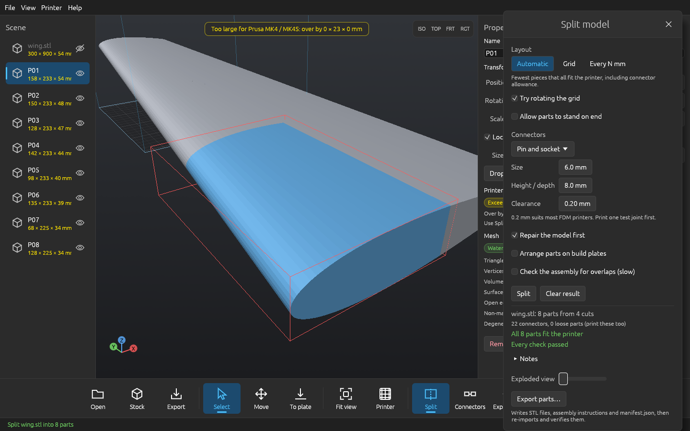
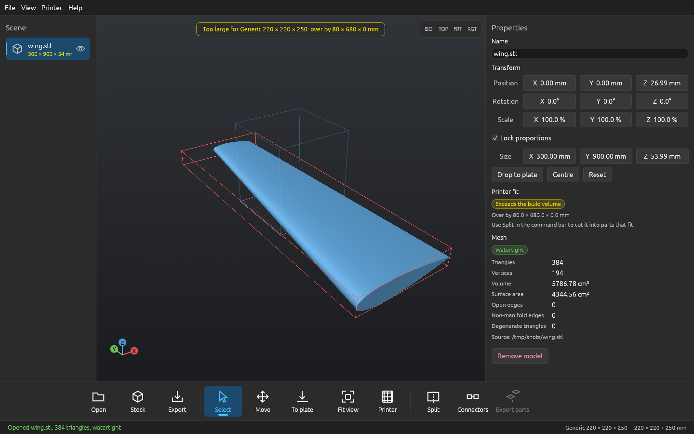
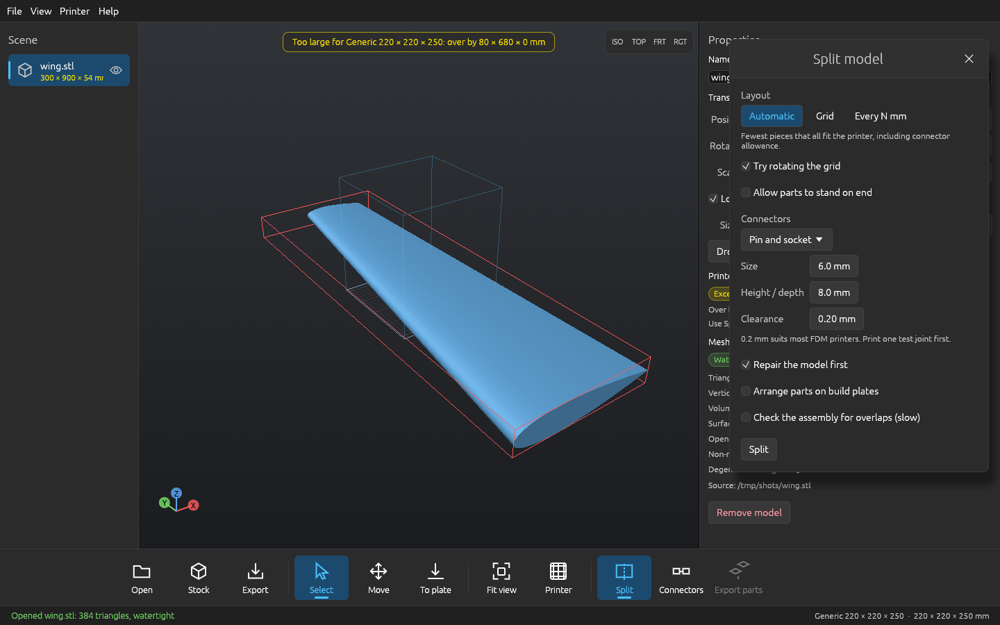
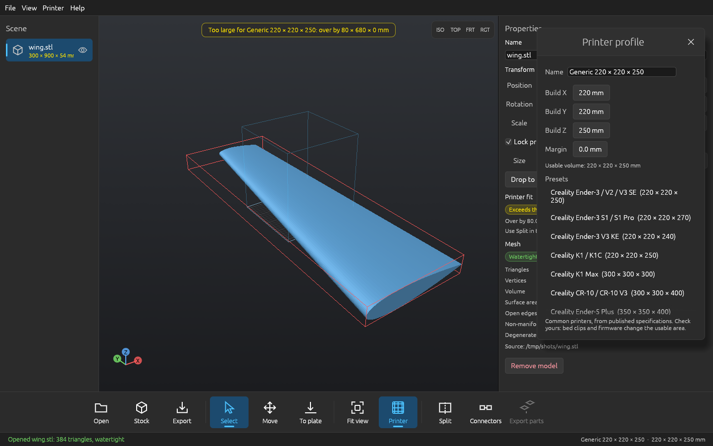
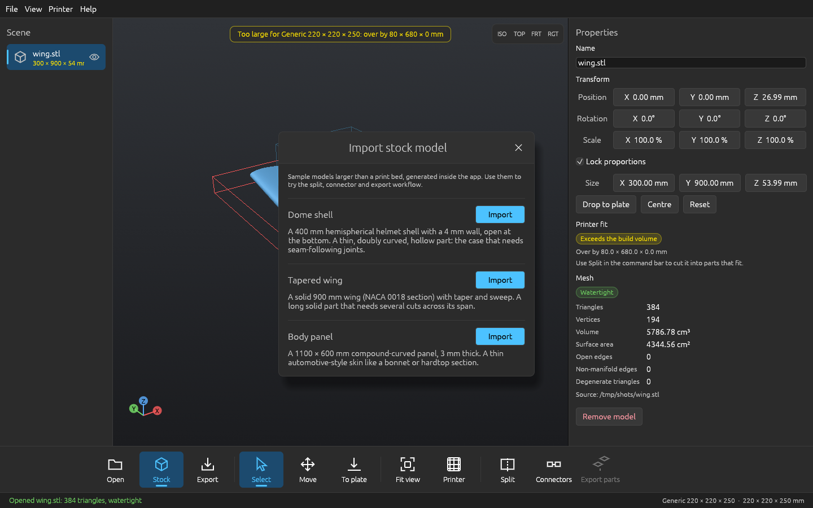
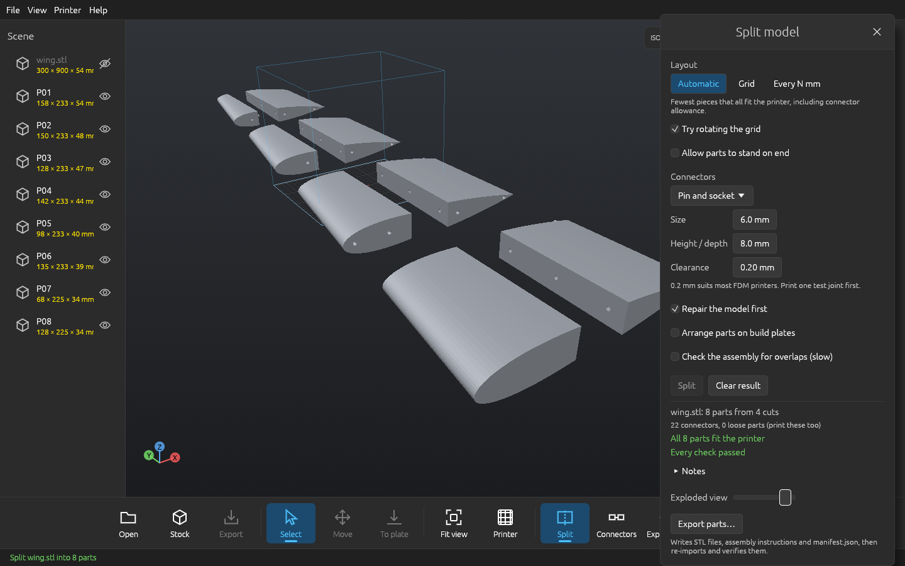
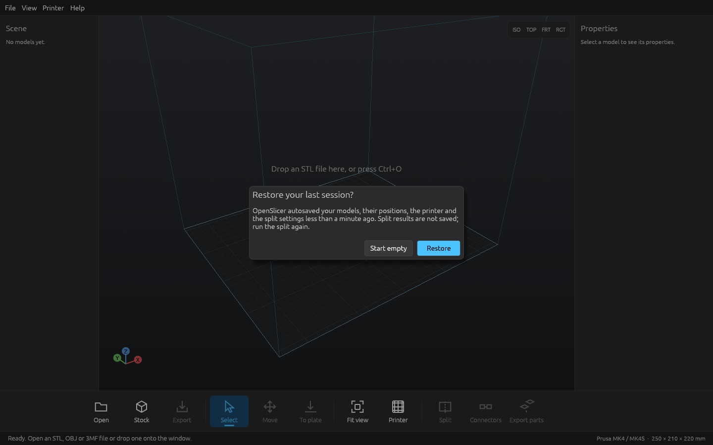
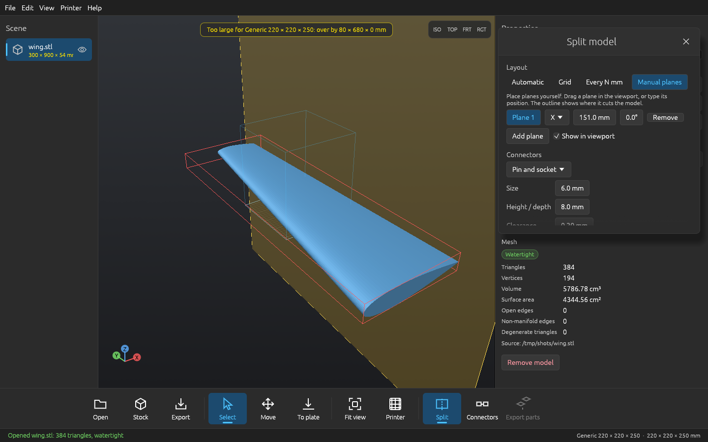
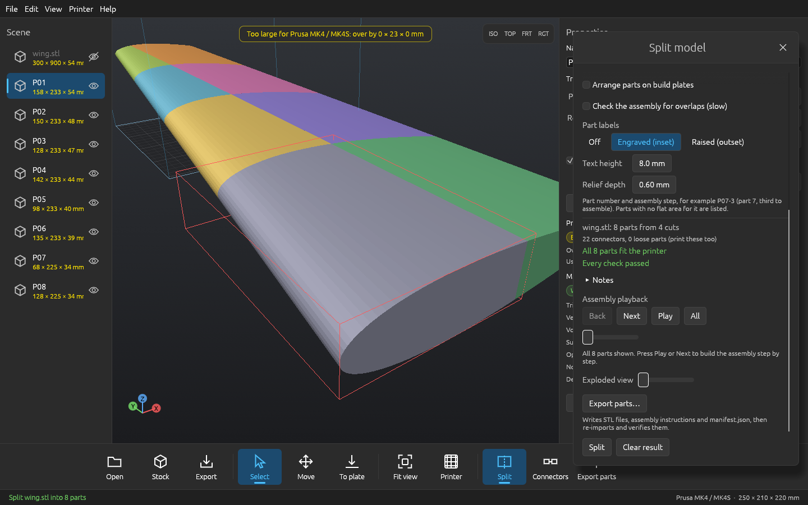
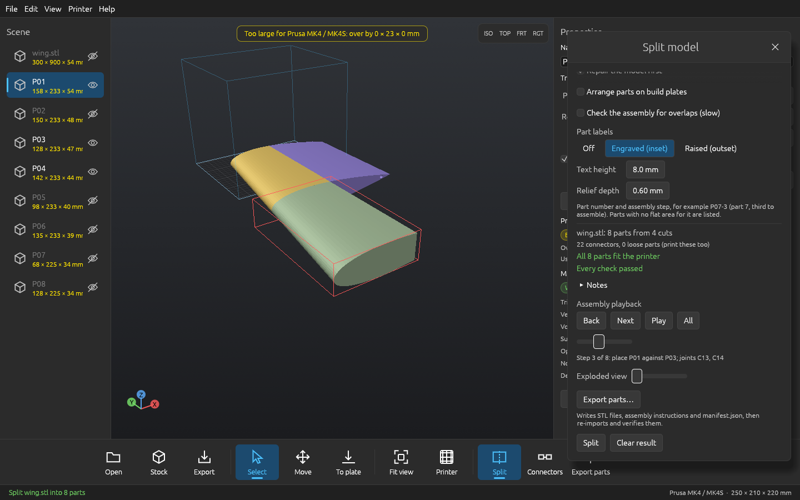

# OpenSlicer

**Open-source, offline software for splitting oversized 3D models into printable parts, joining them with real printable connectors, and planning the assembly.**

Written entirely in Rust. Runs locally: no account, no subscription, no cloud, no network. An open alternative to commercial large-model splitting tools such as LuBan 3D.

> **Status: beta (0.1.0-beta.1).** The geometry engines, command-line tool and the desktop app (automatic, grid and manual-plane splitting, joints for thin shells, part labels, assembly playback, verified export, undo/redo, projects) work and are tested on real generated geometry. Several features are not built yet and a few are weak; both are listed plainly in [Limits and what is not built yet](#limits-and-what-is-not-built-yet). OpenSlicer reports a failed check instead of claiming success, but **always inspect exported parts in your slicer before printing**, and print a test joint first.



*A 900 mm sample wing cut into 8 parts for a Prusa MK4, 22 pin connectors, every check passed. Screenshots were taken on Linux under software OpenGL.*

OpenSlicer is an independent project, not affiliated with, endorsed by, or derived from the source code of LuBan 3D or any other commercial product.

---

## Download and run

Releases are **one file: `openslicer.exe`**: no installer, no archive, no Visual C++ redistributable (the C runtime is linked statically). Download it from the [Releases](https://github.com/CS92604/OpenSlicer/releases) page and double-click it. It needs Windows 10/11 and a GPU driver with OpenGL 3.3. Settings and the autosave are kept in your user profile; delete them to reset.

The Windows build is produced and tested by GitHub Actions. **A person has not yet run it on a real Windows machine**, so report anything odd. The command-line tool is not in the release; build it from source (see [Building](#building)).

## Quick start (desktop app)

1. **Open** a model (STL, OBJ, 3MF; drag-and-drop works), or **Stock** to import one of the three built-in sample models.
2. **Printer**: pick one of 20 common printers or type your own build volume and margin. The viewport warns when a model does not fit.
3. **Split**: choose a layout (automatic, grid, every N mm, or **manual planes** you drag in the viewport), a connector type, size and clearance, and optionally **part labels**. Run it; progress and a Cancel button show while it works.
4. Review the summary: parts fitting the printer, connectors placed, and every problem found. Parts are coloured individually. Drag the **Exploded view** slider, or use **Assembly playback** (Back / Next / Play) to watch the assembly being built step by step.
5. **Export parts** writes one STL/OBJ/3MF per part, assembly instructions (HTML), an **assembly CSV**, optional build plates and a `manifest.json`, then re-imports everything and checks it before reporting success.

|  |  |
|---|---|
|  **Viewer.** Size, volume, mesh health and printer fit for any model. |  **Split window.** Layout, connectors, clearance, repair, nesting, assembly check. |
|  **Printer presets.** 20 common printers plus custom volumes. |  **Stock models.** Three oversized samples generated inside the app. |
|  **Exploded view.** The 8 wing parts pulled apart, pin sockets visible. |  **Autosave.** Your last session is offered back after a crash or close. |
|  **Manual cutting planes.** A translucent plane and the outline where it cuts the model; drag it in the viewport or type its position. |  **Part colours.** Every part of a result has its own colour. |
|  **Assembly playback.** Step 3 of 8: only the parts placed so far are shown. | |

---

## What works

**Desktop app**
- Import STL (binary and ASCII), OBJ, 3MF; multiple models; drag-and-drop; command-line file arguments.
- 3D viewport with build plate, build-volume wireframe, orbit/pan/zoom, view presets, click-to-select, Move tool; numeric position, rotation, scale and size; drop-to-plate.
- Mesh inspection: triangles, area, volume, open and non-manifold edges, degenerate triangles, inverted normals (shown in orange).
- **Printer profiles:** 20 presets, editable volume and margin, per-axis over-size report, saved between sessions.
- **Split window:** automatic layout (searches grid rotation and axis assignment for the fewest parts that fit), grid, every-N-mm cuts, or **manual planes** (axis, position and tilt, with a live translucent preview and the outline where each plane cuts the model; drag a plane in the viewport to move it); 11 connector kinds; clearance; optional repair first, nesting onto plates, an assembly interpenetration check, and **part labels**. Runs in a background job with progress and cancel.
- **Result view:** a pass/fail summary listing every problem and note, per-part colours, an exploded view slider, and **assembly playback** (Back, Next, Play, All, with a one-line description of each step and the part being placed highlighted).
- **Undo / redo** (Edit menu, Ctrl+Z / Ctrl+Y) for adding, removing, moving, rotating, scaling and renaming models. A whole drag or typed value is one step; split results are regenerated rather than undone.
- **Part labels:** the part number and its assembly step (for example `P07-3`) engraved into or raised from each part. See below.
- **Verified export** of parts, instructions and manifest (see below).
- **Stock models:** dome shell, tapered wing, curved body panel.
- **Projects and autosave:** File ▸ Open / Save project (`.osproj`: your models with their positions, the printer, the split settings). A background autosave runs every 10 seconds when the scene changes and offers to restore it at the next start. Preferences and split settings persist.
- Forced dark theme styled after Windows 11 / 3D Builder.

**Geometry engines** (used by the app and the CLI)
- **Cutting:** exact plane cuts with capping, verified watertight and volume-conserving; grid, modular, brick and arbitrary-plane layouts; disconnected solids separated; sliver pieces merged.
- **Connectors:** pin and socket, dowel, dovetail, tab-and-slot, puzzle, lip (follows the cut boundary), lap joint, terrace, pyramid, claw, and the **finger joint** for thin and curved walls. Automatic placement, configurable clearance. Every connector is checked against the real pieces with Booleans.
- **Thin curved shells:** where a pin, tab or lip does not fit a wall (a 3 mm skin, a 4 mm shell), OpenSlicer falls back to a **finger joint** automatically and says so in the notes. Alternate strips along the seam are handed from one piece to the other by Boolean operations on the real pieces, so the joint follows any curve and needs no wall thickness. Both pieces are verified to be closed solids, their volumes must change by exactly the material moved, and the assembled pieces must not overlap.
- **Machine-aware output:** build volume and margin, every part checked in every orientation, print-orientation export, rectangle nesting onto plates.
- **Assembly planning:** contact-driven ordering, exploded offsets, per-step SVG diagrams, HTML instructions and a CSV table (step, part, file, label, parts it attaches to, contact area, joints and their types, size, volume, build plate, fits printer).
- **Mesh operations (CLI):** union, subtract, intersect; repair (weld, orient, fill small holes); hollowing with drain holes.
- **Other construction methods (CLI):** stacked layers with SVG outlines, interlocking ribs, blocks, plates, wireframe, depth relief. **Image tools (CLI):** lithophane, relief, halftone plate.

**Export verification.** Every export is re-imported and compared (SHA-256, triangle count, volume, bounds, printer fit) before it is reported as done. The manifest is removed if verification fails; a failed or cancelled export leaves no files behind; a non-empty destination folder is refused.

## Examples

Real output from the command-line tool (see [docs/example-session.txt](docs/example-session.txt)):

```text
$ openslicer-cli stock
dome   Dome shell - A 400 mm hemispherical helmet shell with a 4 mm wall, open at the bottom. A thin, doubly curved, hollow part: the case that needs seam-following joints.
wing   Tapered wing - A solid 900 mm wing (NACA 0018 section) with taper and sweep. A long solid part that needs several cuts across its span.
panel  Body panel - A 1100 × 600 mm compound-curved panel, 3 mm thick. A thin automotive-style skin like a bonnet or hardtop section.

$ openslicer-cli stock wing -o wing.stl
wrote wing.stl (384 triangles, 300 × 900 × 54 mm)

$ openslicer-cli info wing.stl --printer "prusa mk4"
wing.stl
  384 triangles, 194 vertices, 300.0 × 900.0 × 54.0 mm
  volume 5786.8 cm³, surface 4344.6 cm²
  mesh: closed solid (open edges 0, non-manifold edges 0, degenerate triangles 0)
  Prusa MK4 / MK4S: does not fit; needs splitting

$ openslicer-cli split wing.stl -o out --printer "prusa mk4" --connector pin --nest
wing: 8 parts from 4 cuts
  grid 2×4×1 rotated 0°
  22 connectors, 0 loose parts
  all 8 parts fit the printer
  4 build plate(s), 68% of the plate area used
  note: auto-tiling: 2×4×1 cells of 150×225×54 mm, grid rotated 0° (about 8 pieces; 12 layouts compared)
  wrote 14 files to out (verified by re-import)
exit code: 0

$ openslicer-cli verify out
checked 13 files in out
all files match the manifest and are valid
exit code: 0
```

Thin shells are where connectors are hardest. A 4 mm dome wall is too thin for 6 mm pins, so every seam is joined by a finger joint instead, and the notes say so (the first of seven shown). The parts carry engraved labels, the CSV lists the assembly, and the export verifies:

```text
$ openslicer-cli split dome.stl -o dome_out --printer "prusa mk4" --connector pin --labels inset
dome: 6 parts from 3 cuts
  grid 2×3×1 rotated 0°
  7 connectors, 0 loose parts
  all 6 parts fit the printer
  note: auto-tiling: 2×3×1 cells of 200×133×200 mm, grid rotated 0° (about 6 pieces; 12 layouts compared)
  note: connectors: interface 1: the wall is only 4.0 mm thick; a connector needs at least 4.3 mm (smallest feature 1.5 mm + clearance + minimum wall on both sides).…
  note: labels: 6 of 6 parts labelled (engraved (inset))
  wrote 9 files to dome_out (verified by re-import)
exit code: 0

$ head -4 dome_out/dome_assembly.csv
step,part,type,file,label_on_part,label_status,attaches_to,contact_area_mm2,connectors,connector_types,loose_parts,starts_subassembly,size_x_mm,size_y_mm,size_z_mm,v…
1,P04,piece,dome_P04.stl,P04-1,"placed: on the inside, 4 mm high, 4.0 mm of material behind",,,,,,yes,187.7,133.1,188.3,153.617,,yes
2,P06,piece,dome_P06.stl,P06-2,"placed: on the inside, 4 mm high, 4.0 mm of material behind",P04,1244,C07,Finger joint (thin walls),,no,200.0,141.3,200.0,162.973,,ye…
3,P02,piece,dome_P02.stl,P02-3,"placed: on the inside, 4 mm high, 4.0 mm of material behind",P06,1244,C05,Finger joint (thin walls),,no,191.1,141.1,190.3,163.865,,ye…

$ openslicer-cli verify dome_out
checked 8 files in dome_out
all files match the manifest and are valid
exit code: 0
```

More commands:

```sh
openslicer-cli printers                                    # the 20 presets
openslicer-cli split big.stl -o out --connector dovetail --nest --verify-assembly
openslicer-cli split a.stl b.obj -o out --layout grid --grid 3,2,1 --format 3mf   # batch
openslicer-cli split big.stl -o out --layout planes --plane 0,0,120:0,0,1
openslicer-cli split big.stl -o out --connector comb --labels outset   # finger joints, raised part numbers
openslicer-cli repair broken.stl fixed.stl
openslicer-cli hollow solid.stl hollow.stl --wall 3 --drain-holes 2
openslicer-cli boolean union a.stl b.stl out.stl
openslicer-cli fab stack|interlock|blocks|plates|wireframe|relief model.stl -o out
openslicer-cli image lithophane|relief|halftone photo.png -o out --width 120
```

Exit codes: `0` success, `1` failure, `2` usage error, `3` finished but the result has problems (parts that do not fit, failed checks). A result with problems is still written so it can be inspected.

### The three stock models

| Model | Size | What it tests |
|---|---|---|
| Dome shell | 400 × 400 × 200 mm, 4 mm wall, open at the bottom | thin, doubly curved, hollow part |
| Tapered wing | 300 × 900 × 54 mm, solid NACA 0018 section with taper and sweep | long solid part; connects cleanly |
| Body panel | 1100 × 600 mm, 3 mm skin, compound curvature | bonnet/hardtop-style skin |

They are generated by code (no data files), tested for closed, consistently oriented surfaces and analytic volume, and split through the real pipeline in automated tests on several printers. The solid wing connects with pins; the dome and the panel connect on every seam with finger joints. All three export, re-import and verify, with labels and the CSV.

### Part labels and the assembly CSV

*Labels:* Split window ▸ Part labels ▸ **Engraved (inset)** or **Raised (outset)** (CLI: `--labels inset|outset`, `--label-height`, `--label-depth`). Each part gets its number and assembly step, for example `P07-3` (part 7, third to assemble), built from seven-segment strokes so no font is needed. The label goes on a **flat patch** of the part's own surface found by ray sampling, so it never lands on a pin, a finger step or a socket. Engraved labels prefer hidden places (the inside of a shell, a mating cut face); raised labels are never put on a mating face. The text is added or subtracted with a Boolean and verified (closed solid, exact volume change, raised text fused to the part). Parts with no flat area, or too thin for the relief, are left unlabelled and listed; a label is never forced on.

*CSV:* every export writes `<model>_assembly.csv` (disable with `--no-csv`) and lists it in the manifest, one row per step: step, part, file, label and where it went, parts it attaches to, contact area, joints and their types, size, volume, build plate, fits printer.

### Printer presets

Build volumes are the manufacturers' published figures, entered from memory and **not re-checked against each datasheet**; check yours in the Printer window, because bed clips and firmware change the usable area.

| Printer | Build volume X × Y × Z (mm) |
|---|---|
| Creality Ender-3 / V2 / V3 SE | 220 × 220 × 250 |
| Creality Ender-3 S1 / S1 Pro | 220 × 220 × 270 |
| Creality Ender-3 V3 KE | 220 × 220 × 240 |
| Creality K1 / K1C | 220 × 220 × 250 |
| Creality K1 Max | 300 × 300 × 300 |
| Creality CR-10 / CR-10 V3 | 300 × 300 × 400 |
| Creality Ender-5 Plus | 350 × 350 × 400 |
| Prusa MK3S+ | 250 × 210 × 210 |
| Prusa MK4 / MK4S | 250 × 210 × 220 |
| Prusa MINI+ | 180 × 180 × 180 |
| Prusa XL (single tool) | 360 × 360 × 360 |
| Bambu Lab A1 mini | 180 × 180 × 180 |
| Bambu Lab A1 | 256 × 256 × 256 |
| Bambu Lab P1P / P1S / X1C | 256 × 256 × 256 |
| Elegoo Neptune 4 / 4 Pro | 225 × 225 × 265 |
| Elegoo Neptune 4 Max | 420 × 420 × 480 |
| Anycubic Kobra 3 | 250 × 250 × 260 |
| Sovol SV06 | 220 × 220 × 250 |
| Artillery Sidewinder X2 | 300 × 300 × 400 |
| Voron 2.4 (350 mm) | 350 × 350 × 330 |

---

## Limits and what is not built yet

**Not built yet (planned)**

| Area | Missing |
|---|---|
| Interactive editing | Manual planes are axis-based with a tilt about one other axis (no free 3D rotation handle); no click-to-select of faces; no per-connector add/move/remove; no editing of cuts after a split other than re-running it |
| Thin curved shells | Surface-following **lap joints and lips** on curved 3 mm walls still often fail verification and are replaced by finger joints; no topology-aware cutting that avoids tiny awkward sections; no reinforcement ribs; finger joints lock pieces against sliding along the seam and in the cut direction but need glue or a clip across the seam |
| GUI coverage | Repair, hollowing, Booleans, image tools and the alternative construction methods are **CLI-only**; batch processing of several models in one GUI run; nesting preview; light theme; searchable settings; labels cannot be placed or moved by hand |
| Validation | A dedicated thin-wall check (only connector-fit and label-thickness checks exist); alignment and missing-section checks beyond the interpenetration check; checks of dimensions against tolerances |
| Projects | `.osproj` stores models, positions, printer and settings but **not generated parts or assembly relationships**: they are regenerated by running the split again; the undo history is not saved |
| Performance | The cutting pipeline is single-threaded apart from what the Boolean library does internally; large-model viewport tuning (no level-of-detail) |
| Packaging | Installer (intentionally none: one `.exe` only); code signing, so Windows SmartScreen may warn; macOS and Linux binaries |

**Weak spots in what exists**
- **Finger joints** need walls of at least about 1.5 mm and a seam long enough for two strips; they are a general fallback, not the strongest joint for thick solid parts (use pins or dovetails there). Fingers are rectangular, with no taper or snap.
- **Pins, dowels, tabs, puzzle, pyramid and claw** need a wall of about 4.3 mm or more; on thinner walls the finger joint takes over (unless you disable the fallback in a settings file).
- **Lip and lap joints** often fail Boolean verification on curved thin walls; the fallback then applies and is noted.
- **Dovetails** can be refused (the neck becomes too narrow) or, on large solid parts, fail the volume check; the fallback applies, or the piece is left without connectors and reported.
- **Rare volume mismatch.** On one tested wing layout (Ender-3 volume, 75° rotated grid) one piece's volume differed from expectation by 6.6 mm³ (0.0008%) and was left without connectors, as designed; the cause is not yet understood.
- **Labels** are small on small parts (the search shrinks them to as little as 3 mm characters on a curved shell); check they are printable at your nozzle size. Raised labels on the outside of a part are visible in the finished model.
- **Nesting** packs by bounding rectangle, not true contour.
- **Self-intersection detection** is skipped above 500k triangles.
- Alternative construction methods approximate the model; the report states the fill ratio.

**Not verified**
- **Windows:** built and tested by CI only; no human run yet.
- **Real prints:** connector clearances are presets, not measured fits. Print a test joint first.
- **Automotive scale:** a real Miata-hardtop-class scan has not been processed. Measured so far: a 1M-triangle plane cut with full verification took about 0.8 s, a 1M-triangle Boolean about 4.5 s, a 1M-triangle STL loads in under 3 s with about 260 MB. Real thin, curved, self-intersecting shells may expose more problems than the stock panel does.
- The GUI was exercised on Linux under software OpenGL with scripted mouse input (open, stock import, printer presets, split, manual plane dragging, part colours, assembly playback, undo through the Edit menu, autosave and restore). **Keyboard shortcuts could not be exercised in that rig** (no key events reach the window under Xvfb without a window manager), so they are untested; the same actions are in the menus. There is no automated GUI test suite.

See [docs/known-limitations.md](docs/known-limitations.md) for more detail.

---

## Keyboard shortcuts

| Key | Action |
|---|---|
| Ctrl+O / Ctrl+Shift+O | Open model / open project |
| Ctrl+S | Save project |
| Ctrl+Z / Ctrl+Y (Ctrl+Shift+Z) | Undo / redo |
| Ctrl+E | Export selected model as STL |
| F | Fit view to selection (or plate) |
| 1 2 3 4 | Isometric / top / front / right view |
| Delete | Remove selected model |
| Esc | Back to Select tool |
| Left drag | Orbit (or move model with the Move tool) |
| Right / middle drag, Shift + left drag | Pan |
| Scroll | Zoom |

---

## Building

Requirements: a current stable Rust toolchain (<https://rustup.rs>). On Linux you also need X11 or Wayland, `libxkbcommon` (and `libxkbcommon-x11` for X11) and an OpenGL 3.3 driver (Mesa works). Nothing extra is needed on Windows.

```sh
git clone https://github.com/CS92604/OpenSlicer.git
cd OpenSlicer
cargo build --release                                  # app: target/release/openslicer, CLI: openslicer-cli
cargo test --workspace
cargo run --release -p openslicer-app -- model.stl     # desktop app
cargo run --release -p openslicer-cli -- split model.stl -o out --connector pin
```

The Windows release is built by `.github/workflows/release.yml` (static C runtime, fat LTO, stripped, one file). CI (`.github/workflows/ci.yml`) runs format, clippy, tests and a release build on Ubuntu and Windows for every push.

## Architecture

A Cargo workspace, so the geometry is tested without the GUI.

| Crate | Responsibility |
|---|---|
| `openslicer-core` | Indexed triangle mesh, bounds, measurements, topology checks, cancel/progress control |
| `openslicer-io` | STL, OBJ and 3MF readers and writers, atomic file writes |
| `openslicer-geom` | Plane cutting with capping, 2D polygons, Booleans, repair, hollowing, BVH |
| `openslicer-split` | Cut plans, layouts, auto-tiling, interfaces, piece reduction, orientation, nesting |
| `openslicer-joints` | Connector generation, placement and validation |
| `openslicer-fab` | Alternative construction methods and image tools |
| `openslicer-project` | Printer profiles and presets, the split pipeline, assembly planning, export and manifest, project files, stock models |
| `openslicer-cli` | Command-line tool |
| `openslicer-app` | Desktop application (`openslicer` binary), egui/eframe with an OpenGL renderer |

## Principles

- **Geometry correctness over features.** Never report success when a mesh is invalid; every cut, connector and export is validated and failures are reported plainly.
- **No fake functionality.** No placeholder buttons, simulated progress or stubs presented as finished features.
- **Fail safe.** Operations never modify the source model or a saved project in place; writes are atomic.
- **Local and open.** No proprietary services.

## License

Dual-licensed under **MIT OR Apache-2.0**, at your option: [LICENSE-MIT](LICENSE-MIT) and [LICENSE-APACHE](LICENSE-APACHE). Direct dependencies and their licenses are in [docs/dependencies.md](docs/dependencies.md). `boolmesh` (used for Booleans) is MPL-2.0, and transitive dependencies have not been audited.

## Documentation

- [docs/known-limitations.md](docs/known-limitations.md): limitations and measured performance
- [docs/export-formats.md](docs/export-formats.md): exported files, manifest and project file formats
- [docs/example-session.txt](docs/example-session.txt): command-line transcript
- [docs/dependencies.md](docs/dependencies.md): dependencies and licenses

## Contributing

Run `cargo fmt --all`, `cargo clippy --workspace --all-targets -- -D warnings` and `cargo test --workspace` before opening a pull request. Priorities: geometry correctness, test coverage on real meshes, clear error reporting.
